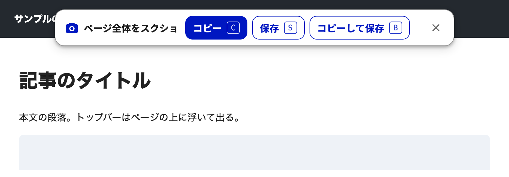

# Full Page Screenshot

Webページの上から下までを、1枚のPNGとしてクリップボードにコピーしたり保存したりするChrome拡張機能です。長いページを何回にも分けて撮り、あとでつなぐ手間をなくします。

## 動作環境

- Google Chrome（Manifest V3に対応した版。Chrome 116以降を想定）
- macOS・Windows・Linux（Chromeが動けばOSは問いません）

## 入れ方

Chromeウェブストアには出していないため、このリポジトリを手元に置いて読み込みます。

1. このリポジトリを複製するか、ZIPでダウンロードして展開する
2. Chromeで`chrome://extensions`を開く
3. 右上の「デベロッパー モード」をオンにする
4. 「パッケージ化されていない拡張機能を読み込む」を押し、このフォルダーを選ぶ

## 使い方

ツールバーのカメラのアイコンを押す（または`Alt+Shift+S`）と、ページの上にトップバーが出ます。

| ボタン | キー | 動き |
| --- | --- | --- |
| コピー | `C` | 画像をクリップボードに入れる |
| 保存 | `S` | ダウンロードフォルダーに保存する |
| コピーして保存 | `B` | 両方 |

撮っている間はトップバーを隠すので、画像には写り込みません。終わると「コピーしました」などと出て、数秒で消えます。途中でやめるときは、`Esc`を押すか、✕を押すか、アイコンをもう一度押します。

保存先は、Chromeのダウンロードの設定（`chrome://settings/downloads`）に従います。ファイル名は`screenshot-サイト名-日時.png`です。

## しくみ

- `chrome.debugger`でDevTools Protocolの`Page.captureScreenshot`（`captureBeyondViewport`）を使い、画面の外まで描画して撮ります。そのため、スクロールしながら撮ってつなぐ方法と違い、固定ヘッダーが何度も写り込みません
- 長いページは4000pxごとに分けて撮り、`OffscreenCanvas`でつなぎます
- 撮る前に一度下までスクロールし、スクロールしないと読み込まれない画像を読み込ませます

| ファイル | 役割 |
| --- | --- |
| `background.js` | アイコンが押されたらトップバーを出し、撮影と保存をする |
| `capture.js` | 撮影とつなぎ合わせ |
| `topbar.js` | ページに出すトップバーとコピー（見た目はデジタル庁デザインシステムに合わせています） |
| `icons/` | アイコン |
| `scripts/check.sh` | `manifest.json`の形式とJSの構文の検査（CIでも実行します） |

## 注意

- 撮っている間、画面の上に「デバッグしています」というバーが一瞬出ます。これは`chrome.debugger`の仕様です
- `chrome://`のページやChromeウェブストアでは撮れません
- `http://`のページなどでは、コピーできないことがあります。保存はできます
- 高さを`100vh`で指定した要素は、縦に引き伸ばされて写ることがあります
- とても長いページは、画像の1辺が32000pxに収まるよう縮小します

## ライセンス

[MIT License](LICENSE)
